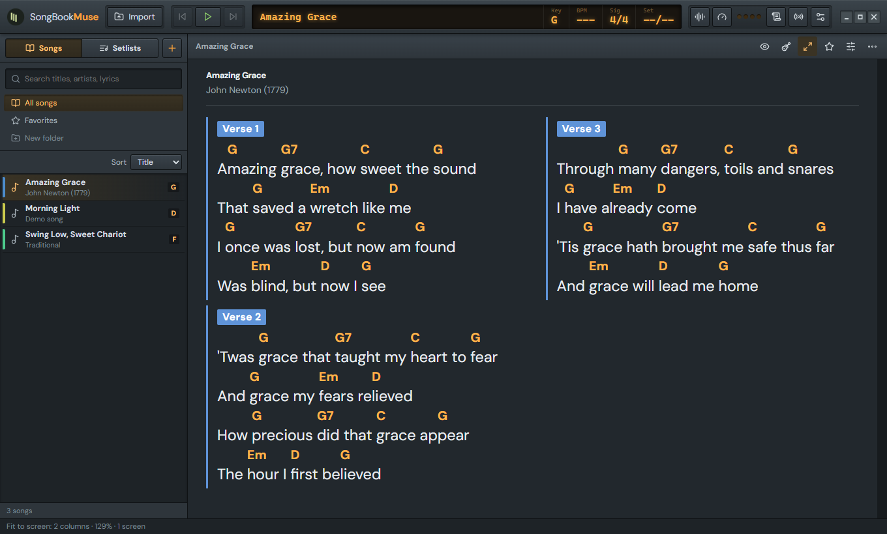
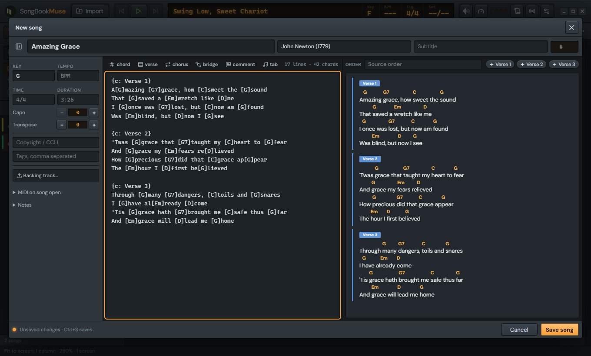
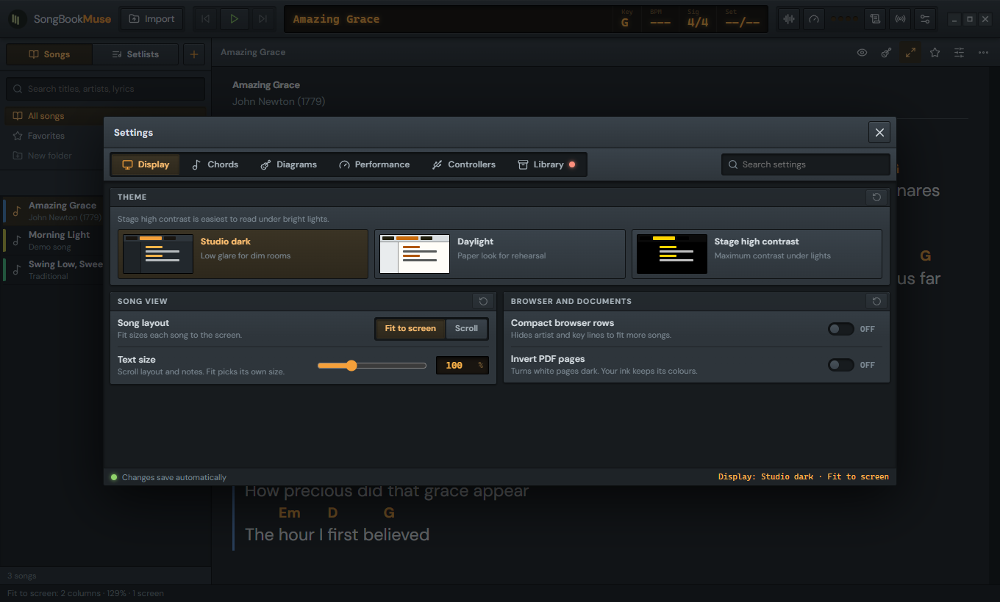

# SongBookMuse

An offline-first digital songbook built on Rust, SQLite and Tauri 2. Use it to organize a song library, edit and transpose ChordPro charts, prepare setlists, and annotate PDFs and images. The desktop build also includes backing-track playback, a metronome, a chromatic tuner and MIDI configuration.



## Download

Windows installers are attached to each [alpha release](https://github.com/gayancc/SongBookMuse/releases). Download `SongBookMuse_<version>_x64-setup.exe` and run it. Alpha builds are not code-signed yet, so Windows SmartScreen may warn about an unknown publisher; choose **More info → Run anyway**. Each installer has a `.sha256` file for checking the download.

To publish a new alpha, create a GitHub release whose tag contains `alpha` (for example `v0.2.0-alpha.1`). The [release workflow](.github/workflows/release.yml) builds the installer and attaches it to that release.

## Features

**Chord charts that fit the screen.** Songs lay out in as many columns as fit, with chords above the lyrics and colour-coded sections. Transpose, set a capo, switch to Nashville numbers, or scroll at the song's own pace.

**A song editor with live preview.** Write ChordPro on the left and see the chart update on the right. Insert chords, sections and tabs from the toolbar, and arrange the section order with one click per section.



**Settings in one window.** Themes for dim rooms, rehearsal and bright stages; chord notation and diagrams; performance timing; MIDI and keyboard pedals; and library backup and restore.



## Run on Windows

Double-click [Run-SongBookMuse.bat](Run-SongBookMuse.bat). It opens an existing build or builds the app on first launch.

Use current stable Rust with MSVC, Node.js 22.13 or newer, and WebView2. Install any remaining Windows dependencies from the [Tauri setup guide](https://v2.tauri.app/start/prerequisites/).

```powershell
npm ci
npm run tauri -- dev
```

Windows x64 and Android ARM64 debug packages have been built. Windows UI tests passed, and Android device testing remains open. See the [build instructions](docs/BUILD.md) for package commands and platform status.

## Restore a backup

Open **Settings → Restore backup**, select a backup file, and review the counts. **Merge** reuses exact title/body matches and preserves current preferences. **Replace** replaces the current library and preserves separate records from the backup. The app validates the file before either action.

You can create a native backup from **Settings → Export backup**.

## Verify

```powershell
cargo test -p muse-core
cargo test -p muse-core restores_untouched_original_fixture -- --ignored --exact
npm run tauri -- build --debug --no-bundle
npm run test:ui
```

The private fixture is excluded from source control. Run its test when you have access to the original sample. The test checks its exact SHA-256. Set `MUSE_SBP_FIXTURE` if the sample is stored outside `fixtures/private`. The Windows UI suite uses a temporary SQLite library and a separate WebView2 profile.

See [build and distribution](docs/BUILD.md) and [testing](docs/TESTING.md) for platform support and verification.
